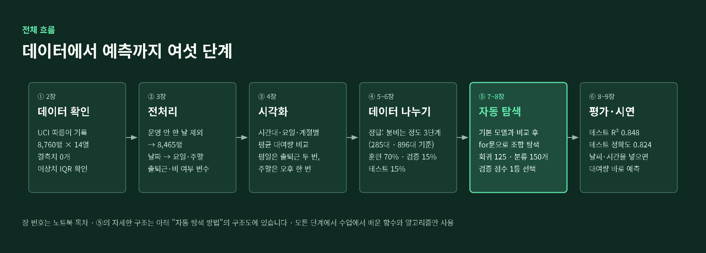
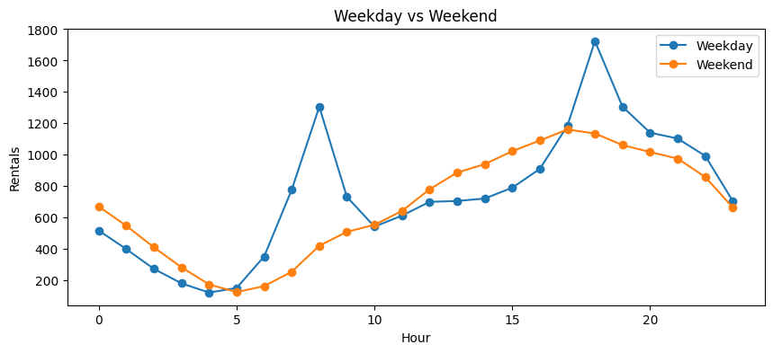
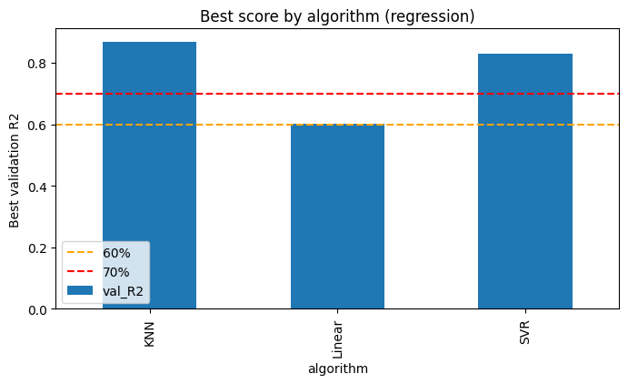
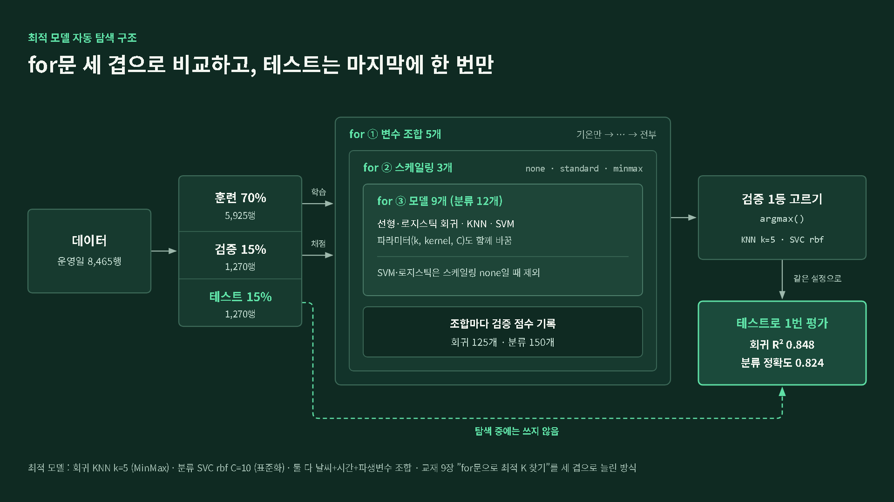
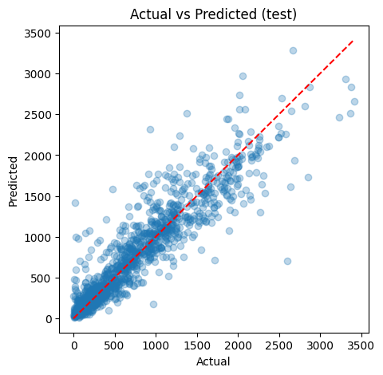
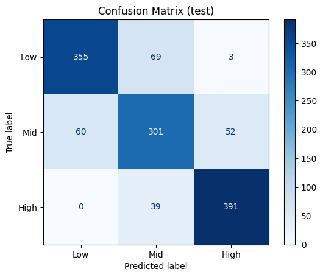

# 따릉이 대여 수요 예측

**날씨와 시간만으로 따릉이 대여량을 예측하고, 가장 잘 맞히는 모델을 `for`문으로 자동으로 찾는 프로젝트**


[](https://colab.research.google.com/github/jihooni217/datamining-ttareungi/blob/main/%EB%94%B0%EB%A6%89%EC%9D%B4_%EC%88%98%EC%9A%94%EC%98%88%EC%B8%A1%28%EC%B5%9C%EC%A2%85%29.ipynb) ← 누르면 노트북이 코랩에서 바로 열립니다 (실행 결과 포함)

## 발표 영상 (1분 30초)

프로젝트 소개, 자동 탐색 구조, 코랩 실행 화면과 시연을 담았습니다. 아래 화면의 재생 버튼을 누르면 바로 볼 수 있습니다. 처음에는 소리가 꺼져 있으니 스피커 아이콘을 눌러 켜 주세요.

https://github.com/user-attachments/assets/3b90bfa2-ed7f-4fd0-9561-64fb0aba7f74

## 왜 했나

따릉이는 퇴근 시간(18시)에 한 시간 평균 1,554대가 빌려지지만, 새벽 4시에는 137대뿐입니다. 몇 시에 몇 대가 빌려질지 미리 알면 모자라기 전에 채워 두고, 한가한 시간에 고장 난 자전거를 고칠 수 있습니다.

그래서 서울 따릉이 1년 치 기록(약 8,500시간)으로 **"이 날씨, 이 시간이면 몇 대가 빌려질까?"**를 예측했습니다.

과제 조건이 "수업에서 배운 것만으로 구현"이라 AutoML 라이브러리는 쓸 수 없었습니다. 그래서 수업에서 배운 모델들을 `for`문으로 하나씩 바꿔 가며 점수를 매기고, 가장 잘 맞히는 모델을 고르는 자동 탐색을 직접 만들었습니다.

## 결과

- **대여량 예측**: 처음 보는 테스트 데이터에서 대여량 변화의 **85%를 설명**했습니다 (R² 0.85. 시간마다 오르내리는 대여량의 85%를 모델이 따라간다는 뜻). 한 시간 예측이 평균 **155대 정도** 빗나갑니다 (평균 대여량은 시간당 약 730대).
- **붐비는 정도 예측**: 적음 / 보통 / 많음 세 단계를 **82% 맞혔습니다.** 한산한 시간을 붐빈다고 크게 틀린 경우는 1,270건 중 3건뿐입니다.
- 모델을 고르는 단계의 점수로 비교하면, 가장 단순한 직선 모델(선형회귀)은 60%, 자동으로 고른 모델(KNN)은 87%였습니다.

| 예시 상황 | 예측 대여량 | 붐비는 정도 |
|---|---|---|
| 여름 평일 퇴근길 (18시, 25도, 맑음) | 2,743대 | 많음 |
| 가을 평일 출근길에 비 (8시, 15도, 비 5mm) | 138대 | 적음 |
| 겨울 주말 새벽 (5시, -8도) | 37대 | 적음 |

여름 퇴근길과 비 오는 출근길만 비교해도 20배 가까이 차이 납니다.

## 이렇게 쓸 수 있습니다

- **자전거 재배치**: 평일 17~19시 수요가 가장 많으므로, 그 전에 자전거를 미리 채워 둡니다.
- **정비 일정**: 수요가 가장 적은 새벽 3~5시, 비 예보가 있는 날, 겨울에 정비를 몰아서 합니다.
- **수요 예보**: 일기예보(기온, 습도, 강수 등)를 넣으면 다음 날 시간대별 예상 대여량을 미리 볼 수 있습니다.

## 전체 흐름



## 문제를 풀어 간 과정

**1. 언제 타는지부터 봤습니다.** 평일은 출근(8시 평균 1,306대)과 퇴근(18시 1,724대)에 두 번 크게 오르고, 주말은 오후(17시 1,161대)에 한 번만 오릅니다. 평일은 출퇴근용, 주말은 여가용입니다.



**2. 선형회귀는 대여량을 음수로 예측했습니다.** 검증 데이터 1,270개 중 118개가 0보다 작았습니다. 선형회귀는 조건마다 정해진 값을 더하고 빼기만 해서, 겨울 새벽처럼 춥고 이른 시간에는 빼는 값이 쌓여 0 밑으로 내려갑니다. 게다가 대여량은 시간에 따라 직선으로 늘지 않고 출퇴근 때만 튀어 오르기 때문에, 직선 하나로는 잘 맞지 않았습니다.

**3. 그래서 변수를 직접 만들었습니다.** "출퇴근 시간인가", "비가 오는가"를 0/1 변수로 만들어 넣자, 설명력이 52%에서 60%로 올랐습니다. 그래도 직선 모델로는 한계가 있었습니다.

**4. 모델을 자동으로 비교했습니다.** 어떤 변수를 쓸지, 숫자 크기를 어떻게 맞출지(스케일링), 어떤 알고리즘을 쓸지를 `for`문으로 하나씩 바꿔 가며 125가지 조합을 평가했습니다. 훈련 데이터에서 날씨·시간 조건이 가장 비슷한 기록 5개의 평균으로 예측하는 KNN이 가장 좋았습니다.



**5. 변수를 다 넣는다고 좋아지지 않았습니다.** 변수 조합마다 가장 잘 맞힌 모델의 검증 R²로 비교하면, 변수를 전부 쓴 조합(0.848)보다 날씨 + 시간 + 직접 만든 변수 조합(0.868)이 더 좋았습니다. 점수가 가장 크게 오른 때는 날씨 변수에 시간 변수(시각, 계절, 공휴일, 주말)를 더했을 때였습니다(0.612 → 0.861). 날씨만으로는 부족하고, "언제인가"를 알아야 대여량을 잘 맞힐 수 있었습니다.

## 자동 탐색 방법

수업에서 배운 "K를 바꿔 가며 가장 좋은 KNN 찾기"를 변수 조합, 스케일링, 모델의 세 겹으로 넓힌 구조입니다.



```
변수 조합 5개  ×  스케일링 3가지(없음 / Standard / MinMax)  ×  모델 후보
```

- **변수 조합**: 기온만 / 날씨 / 날씨+시간 / 날씨+시간+파생변수 / 전체
- **회귀 후보 9개**: 선형회귀, KNN(k=3, 5, 7, 10, 15, 20), SVR(rbf, C=10, 100) → 125개 조합
- **분류 후보 12개**: 로지스틱 회귀(C=0.1, 1, 10), KNN(k=3, 5, 7, 10, 15, 20), SVC(linear, rbf C=1, 10) → 150개 조합
- 로지스틱 회귀와 SVM은 스케일링하지 않으면 학습이 잘 안 되거나 매우 느려서, 스케일링한 경우만 돌렸습니다.
- 데이터를 훈련 70% / 검증 15% / 테스트 15%로 나눴습니다. 모델은 **검증 점수**로 고르고, 테스트 데이터는 마지막 평가에 한 번만 썼습니다.
- 붐비는 정도는 대여량을 3등분(285대 미만 / 285~896대 / 896대 이상)해서 정답을 만들었습니다.

| 과제 | 최적 모델 | 검증 점수 | 테스트 점수 |
|---|---|---|---|
| 대여량 (회귀) | KNN, k=5, MinMax 스케일링 | R² 0.868 (선형회귀 0.603) | **R² 0.848**, RMSE 247대, MAE 155대 |
| 붐비는 정도 (분류) | SVM(SVC), rbf, C=10, 표준화 | 정확도 0.842 | **정확도 0.824**, F1(macro) 0.823 |

최적 회귀 모델의 훈련 R²는 0.907, 검증 R²는 0.868로 차이가 0.04라 과대적합은 크지 않습니다.




분류에서 틀린 것은 대부분 '보통'과 헷갈린 경우입니다. 한산한 시간(적음)을 붐빈다(많음)고 틀린 경우는 3건, 반대는 0건입니다.

### 그 밖에 확인한 것

- **무엇이 가장 영향을 주나**: 기온은 도, 습도는 %처럼 단위가 달라서 표준화한 뒤 선형회귀 계수를 비교했습니다. 기온(+371)이 가장 크고, 시간(+184), 출퇴근 여부(+166), 습도(-128), 비 여부(-120) 순입니다.
- **이상치**: IQR 방법으로 상한 2,389대를 넘는 152행을 찾았습니다. 대부분 17~20시의 여름·가을이라 실제 퇴근 수요로 보고 지우지 않았습니다.
- **평가 지표**: MAPE는 실제 대여량이 0인 시간이 있어 계산할 수 없어서 R², RMSE, MAE를 썼습니다.

## 한계

- 1년 치 데이터를 무작위로 나눠서, 같은 날의 다른 시간이 훈련 데이터에 들어 있습니다. 다음 해를 예측하면 점수가 떨어질 수 있습니다. 여러 해 데이터가 있다면 앞 해로 학습하고 뒤 해로 평가해야 합니다.
- 대여량이 아주 많은 시간(2,500대 이상)은 실제보다 낮게 예측하는 경향이 있습니다.
- 대여소 위치, 행사, 미세먼지처럼 데이터에 없는 요인은 반영하지 못했습니다.

## 맡은 역할

3인 팀의 팀장으로 프로젝트 전 과정을 맡았습니다.

- 주제 선정과 데이터 확인 (인코딩, 결측치, 운영하지 않은 날 처리)
- 전처리와 파생변수 설계 (출퇴근 여부, 비 여부, 요일)
- 자동 탐색 구조 설계와 구현, 모델 평가
- 생성형 AI 결과 검증 (수업 범위 밖 함수 찾아 교체, 실행 결과와 설명 대조)
- 발표 영상 제작 (대본, TTS, 자막, 시연 화면)

## 생성형 AI 활용

Claude로 주제를 정하고 노트북 초안을 만들었고, ChatGPT로 코드를 검토받았습니다. AI가 넣은 함수 중 수업 실습에 없던 5개(`heatmap`, `corr`, `sort_values`, `quantile`, `hasattr`)는 실습에 있는 함수로 바꿨습니다. 입력한 프롬프트와 검증·수정한 내용은 노트북 11장에 정리했습니다.

## 데이터

- UCI Machine Learning Repository의 [Seoul Bike Sharing Demand](https://archive.ics.uci.edu/dataset/560/seoul+bike+sharing+demand) (2017.12 ~ 2018.11, 한 시간 단위 8,760행 × 14열, CC BY 4.0)
- 결측치는 없습니다. 운영하지 않은 날 295시간은 대여량이 모두 0이라 빼고 8,465행을 썼습니다.
- 원본 CSV에 `°C` 기호가 있어서 `encoding='cp1252'`로 읽습니다.

## 파일 구성과 실행 방법

| 경로 | 내용 |
|---|---|
| `따릉이_수요예측(최종).ipynb` | 분석 노트북 (코랩 실행 결과 포함) |
| `따릉이_발표영상(github용).mp4` | 발표 영상 (TTS 음성 + 자막) |
| `data/SeoulBikeData.csv` | 원본 데이터 (UCI에서 받은 것과 같은 파일) |
| `scripts/check.py` | 데이터를 처음 열어 볼 때 쓴 확인용 스크립트 |
| `docs/images/` | README 그림 (노트북 출력 그래프 4장, 전체 흐름도, 자동 탐색 구조도) |

1. 맨 위의 "Open in Colab" 배지를 눌러 노트북을 Google Colab에서 열고 위에서부터 차례로 실행합니다. 데이터는 UCI 주소에서 바로 읽어 옵니다. 자동 탐색(8장)은 2~3분 걸립니다.
2. UCI 주소가 막혀 있으면 `data/SeoulBikeData.csv`를 코랩에 올리고, `read_csv`의 주소를 파일 이름으로 바꿉니다.
